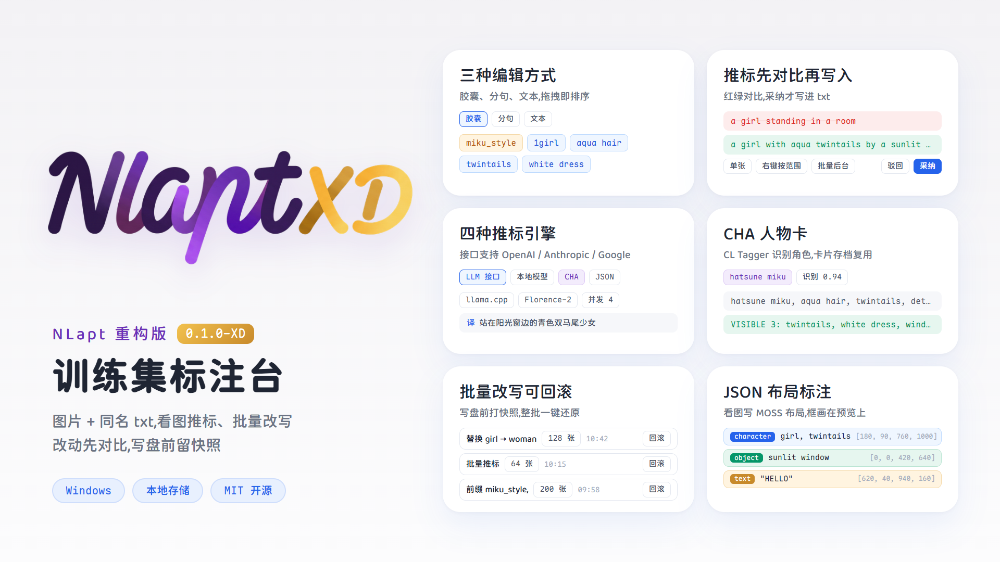

<p align="center">
  
</p>

<p align="center"><b>NLapt 重构版</b> · Windows 桌面端的训练集标注台</p>

<p align="center">
  
  
  
  
  
  <a href="https://nasa-ammos.github.io/slim/"></a>
</p>

---

NLaptXD 编辑 LoRA 等训练集的自然语言标注:一张图配一个同名 `.txt`。可以手改,也可以让视觉模型看图推标,再批量查找替换、加前后缀、翻译。

它是 [NLapt](https://github.com/storyAura/NLapt) 的重构版,从 Python + PySide6 改为 Flutter,界面采用 [Penna](https://github.com/storyAura/Penna) 的设计语言。功能和数据安全规则与旧版保持一致:**编辑只改内存,保存才写盘;批量写盘前先打快照,可以整批回滚。**

<p align="center">
  
</p>

[问题反馈](https://github.com/storyAura/NlaptXD/issues) · [旧版 NLapt](https://github.com/storyAura/NLapt)

## 功能

### 浏览与编辑

- 打开数据集文件夹:递归扫描,图片与同名 txt 配对,按 kohya 文件夹分组;下次启动打开上次的数据集。
- 列表 / 网格浏览,按文件名与标注搜索,筛选全部 / 未标注 / 未保存;多选,预览缩放,四图对比。
- 三种编辑方式:**胶囊**(按逗号拆成标签,拖拽排序,带浮动工具条)、**分句**(拖拽重排)、**文本**;触发词锁定显示。
- 保存 / 全部保存(原子写入),每张图有逐步历史,可撤销、重做。

### 推标

- 四种引擎:
  - **LLM 接口**:OpenAI / Anthropic / Google 三种格式,在接口卡片上选择;可拉取模型列表、测试连接。
  - **本地模型**:GGUF 由 llama.cpp 运行,Florence-2 在程序内用 ONNX 运行。
  - **CHA**:分层生成角色卡;CL Tagger 识别角色,逐张只保留图里看得见的细节,角色卡存档复用。
  - **JSON**:看图写 MOSS-Image 布局 JSON,框画在预览图上,编辑区逐框显示成卡片。
- 单张结果以红绿对比呈现,采纳后才写入;批量推标有进度卡,可转入后台或取消,失败的重试一次并按原因归类。
- 右键按范围推标;在线接口可并发;发送前把图缩到长边 1024 的 JPEG。
- 回答自动清洗,识别模型拒答;被拒或出错的那张保留原文。
- 系统提示词可保存多套方案。

### 批量与翻译

- 批量查找替换、前缀 / 后缀:执行前自动打包快照,操作日志页可整批回滚。
- 翻译服务:大模型 / Google / 百度 / DeepL / DeepLX / 自定义,按顺序备选,按内容缓存;支持胶囊翻译、底部译文和批量翻译对照。

### 其他

- 深浅色两套配色,以圆形扩散切换。
- 第一次启动时从旧版 NLapt 导入接口、模型、系统提示词与 HF Token。

## 目录

- [快速开始](#快速开始)
- [数据与隐私](#数据与隐私)
- [开发](#开发)
- [更新记录](#更新记录)
- [常见问题](#常见问题)
- [参与贡献](#参与贡献)
- [许可](#许可)
- [联系](#联系)

## 快速开始

### 环境要求

- Windows 10 / 11(x64)
- [Flutter](https://flutter.dev) 3.47 及以上(Dart 3.13 及以上),以及 Visual Studio 的「使用 C++ 的桌面开发」组件
- PowerShell 7(`pwsh`)

### 编译与运行

暂未发布安装包,需要从源码编译:

```powershell
git clone https://github.com/storyAura/NlaptXD.git
cd NlaptXD
flutter pub get
pwsh tool/build.ps1          # 产物:build\windows\x64\runner\Release\nlaptxd.exe
```

> 路径中含中文时,部分 Flutter 命令会出错。`tool/build.ps1` 会把项目目录临时映射成一个盘符再编译,所以请用它编译,不要直接运行 `flutter build`。

### 使用

1. 运行 `nlaptxd.exe`,在标注台打开一个「图片 + 同名 txt」的文件夹。
2. 在「模型」页添加接口(Base URL、API Key、模型),或在「本地模型」页下载并启动本地模型。
3. 选中图片,点「推标」;确认红绿对比后采纳,保存即写入 txt。

## 数据与隐私

数据集文件夹里只有图片和 txt。程序自己的数据都放在本机「文档\NLaptXD」:

| 内容 | 位置 |
| --- | --- |
| 设置(含 API Key,明文) | `config.json` |
| 本地模型设置、下载的模型与运行时 | `local.json`、`models\`、`runtime\` |
| 每个数据集的快照与操作日志 | `datasets\<文件夹名>-<路径指纹>\`(`backups\` 最多保留 20 份,`oplog.json`) |
| CHA 角色卡存档 | 同上,`cha_cards.json` |

推标时,图片和提示词会发送到你配置的接口;使用本地模型时不会离开本机。

设置环境变量 `NLAPTXD_HOME` 可以把数据目录换到别处。

## 开发

```powershell
dart analyze lib test        # 静态检查(不要用 flutter analyze)
flutter test                 # 全部测试
pwsh tool/build.ps1 -Mode debug
```

代码结构:

```
lib/
  core/            纯 Dart:标注分段、数据集扫描、原子写、历史、查找替换、快照与日志、
                   LLM 客户端、CHA、JSON 标注、翻译、本地模型
  data/            配置读写、旧版设置迁移、Florence-2 推理
  ui/              界面:标注台、操作日志、模型、本地模型、设置
test/              单元测试与界面冒烟测试
prototype/         网页原型(python prototype/build.py)
tool/build.ps1     Windows 编译脚本
```

## 更新记录

- **0.1.0-XD**:第一个公开版本,包含上面列出的全部功能。

尚未完成的功能:图像工具(替换透明底、雷同图隔离)、崩溃后恢复草稿、导出 zip、编辑训练集对照组、本地翻译模型。

## 常见问题

1. **能和旧版 NLapt 一起用吗?**
   可以。两者读写的都是同一份 txt。旧版放在数据集里的 `.nlapt` / `.backups` 会在打开时搬到 NLaptXD 的数据目录。
2. **支持 macOS / Linux 吗?**
   目前只有 Windows。
3. **API Key 存在哪里?**
   以明文存在「文档\NLaptXD\config.json」,与旧版的 `api.json` 做法相同。不要把这个文件分享给别人。

## 参与贡献

1. 先开一个 [issue](https://github.com/storyAura/NlaptXD/issues) 说明问题或想法。
2. Fork 本仓库,在自己的分支上修改。
3. 提交前运行 `dart analyze lib test` 与 `flutter test`,确认全部通过。
4. 提交信息使用 conventional commits(`feat:` / `fix:` / `chore:` …),然后发起 Pull Request。

## 许可

源代码以 [MIT](LICENSE) 许可发布。

随程序分发的第三方内容保留各自的许可:

| 内容 | 许可 |
| --- | --- |
| [Maple Mono](https://github.com/subframe7536/maple-font)(`fonts/MapleMono-Regular.ttf`) | SIL OFL 1.1,见 [fonts/MapleMono-LICENSE.txt](fonts/MapleMono-LICENSE.txt) |
| [霞鹜 975 圆体](https://github.com/lxgw/975Yuan)(`fonts/LXGW975YuanSC-500W.ttf`) | SIL OFL 1.1,见 [fonts/LXGW975Yuan-LICENSE.txt](fonts/LXGW975Yuan-LICENSE.txt) |
| Material Icons(`fonts/materialicons-regular.otf`) | Apache 2.0,见 [fonts/materialicons_license.txt](fonts/materialicons_license.txt) |

使用时下载的模型与运行时([llama.cpp](https://github.com/ggml-org/llama.cpp)、[ONNX Runtime](https://github.com/microsoft/onnxruntime)、Florence-2、[CL Tagger](https://huggingface.co/Nonene/cl_tagger) 等)遵循各自的许可。

## 联系

维护者:[storyAura](https://github.com/storyAura)。问题和建议请提 [issue](https://github.com/storyAura/NlaptXD/issues)。
